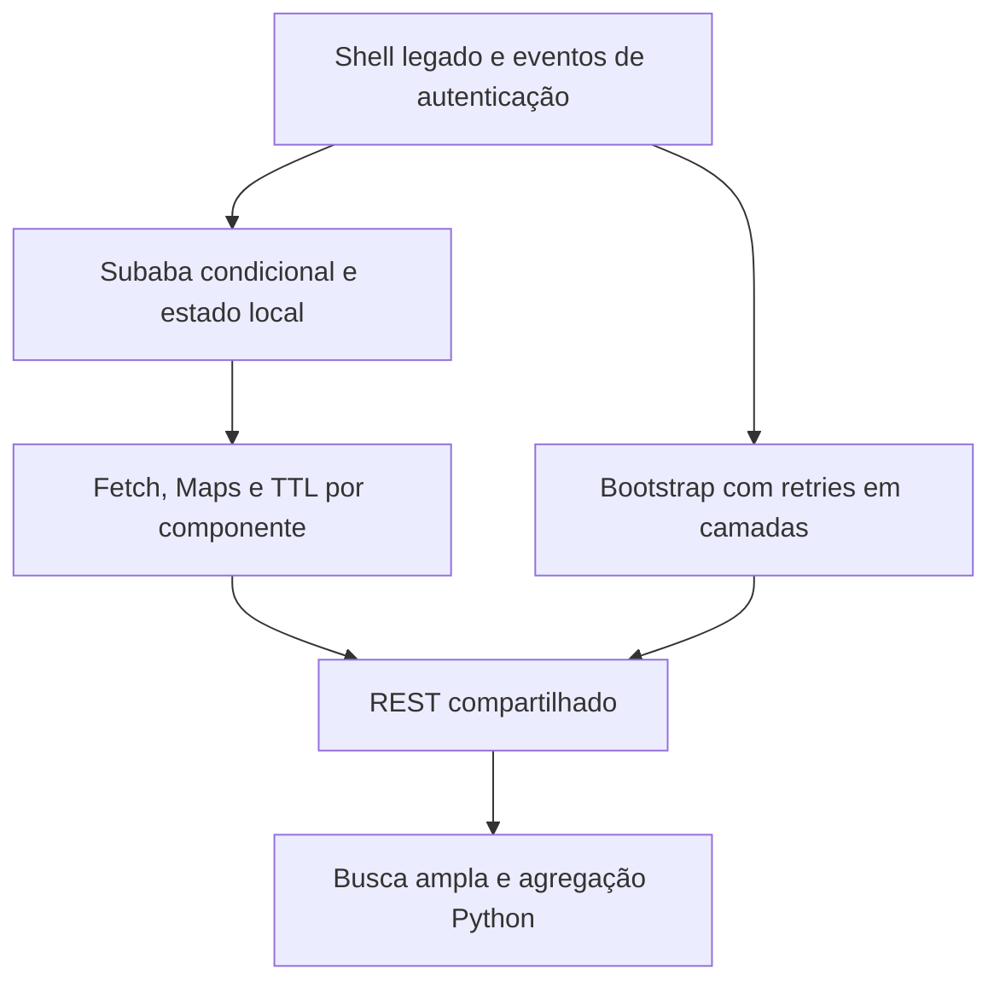
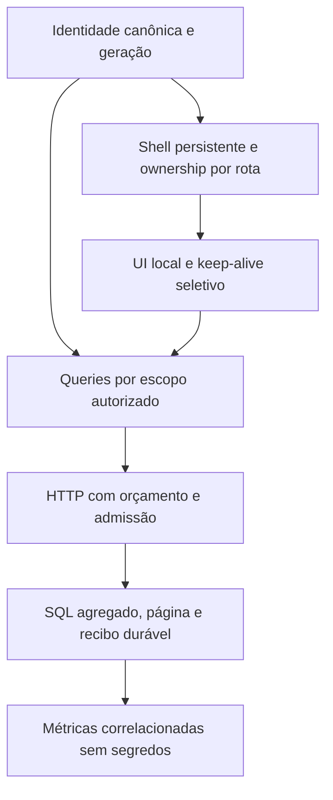

# Arquitetura Runtime V2
## Antes

## Depois

A ponte legada sinaliza ativação do módulo sem falsificar tasks.view. Eventos de perfil não são eventos de navegação. Mudança efetiva de identidade/acesso cancela e limpa queries e snapshots; resposta antiga nunca substitui o novo contexto.

Queries remotas, estado visual e autenticação têm ciclos separados. Reentrada fresca não busca; reentrada stale faz uma revalidação mantendo o DOM. Falha transitória de identidade torna o shell inerte e preserva estado; recuperação da mesma identidade revalida queries falhas/stale sem remontagem.

HTTP analytics usa semáforo por processo. Os novos RPCs usam quatro locks transacionais não bloqueantes, que só se liberam ao término real da transação. Analytics legado ainda depende da admissão HTTP; configuração real de pool/pre-request não foi obtida. Não se atribui a causa dos incidentes a Supabase, VPS ou índices sem correlação.

Escritas finais adotadas têm ID de intenção no cliente, fingerprint e recibo no banco. Repetição confirmada retorna recibo; concorrência e resultado incerto bloqueiam nova execução. Nenhuma falha de transporte confirma uma operação.

## Operação dos recibos
Ferramenta de auditoria fora da imagem do aplicativo: transação somente leitura, timeout 2 s, até 1.001 ativos para amostra máxima de 1.000, saída agregada sem identidades/conteúdo. Não tem modo de liberação. Todos os recibos são retidos nesta versão; qualquer futura compactação depende de preservar a prova de idempotência e passar testes de replay. Ver WRITE-RECOVERY.md.

Os dois RPCs analíticos novos distribuem orçamento remanescente entre fases HTTP, com leitura até 4 s e soma das fases dentro do restante dos 8 s. Isso corrige corte prematuro da candidata demonstrado em fixture SQL de 2,3 s. Não muda autenticação, escrita, retry ou a capacidade admitida. A origem dos timeouts publicados segue não comprovada.

## Adendo de 25/10/2026
UploadService → auth_import_processes com classifier_classification dentro de p_rows; eliminado PATCH posterior. Processos → TaskService (CNJ/carteira/permissão/responsável) → processos_create_task atômica. Ambas as funções já existem; fixtures preservam ACL de backend.
