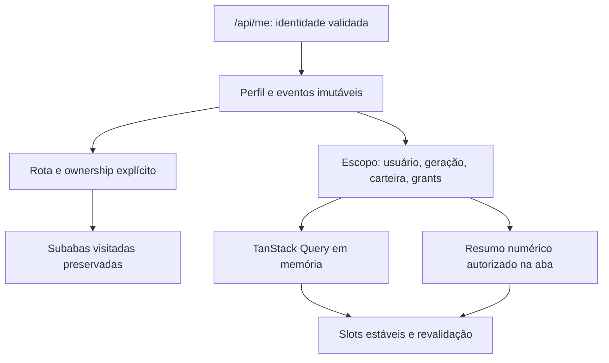

# Responsabilidades

| Estado | Dono | Invalidação |
|---|---|---|
| Identidade/autorização | auth.js + backend | logout, revogação, perfil |
| Carteira | MBA_API + política | mudança de carteira |
| Rota/shell | History API + shell | navegação de documento |
| Filtros/seleção/rascunho | componente/store de UI | mudança real de escopo |
| Dados remotos | consulta por chave autorizada | TTL/mutação/escopo |

Antes: autenticação → grants temporariamente alterados → loaders; rota externa → execution → unmount; dashboard → barreira de quatro endpoints.

Depois pretendido: identidade → cópia de evento; rota → ativação explícita; subaba visitada → mesma instância; consulta → estado por chave; resumo/detalhe → atualização independente.

Nenhum snapshot local concede acesso. Browser abort não garante cancelamento SQL. Falha de analytics não pode consumir toda capacidade de auth/write. Implementação de isolamento exige benchmark e gate separado.

## Implementação candidata

A ponte legada recebe mba:module-activated com {pageId,user}; os loaders verificam o módulo e seu proprietário. mba:authenticated permanece evento de identidade, com cópia congelada. /api/me valida antes da restauração de qualquer agregado persistido. Na inicialização com credencial existente, o shell fica visível e inert; ações e leituras protegidas ficam bloqueadas até concluir a validação. A geometria de Produtividade pode existir sem valores autorizados.

A query de Produtividade inclui escopo completo, filtros e versão. TTL de frescor 45 s; dashboards 60 s; sem retry automático de queries. Snapshot persistente: quatro agregados numéricos, até 4 KiB, schema 1, TTL 120 s e checksum de corrupção; não contém pessoas, documentos, tokens ou listas. Não representa autorização nem prova criptográfica de autenticidade. Preferências de filtros/ordenação têm escopo separado. Quota/corrupção cai para memória/requisição.

Resumos, análises, Benner e aging publicam estados separadamente. Promise.allSettled só encerra o indicador global de atividade; não é barreira para setDados. Mudanças de identidade/carteira/grants descartam respostas, cancelam espera e limpam dados antes de reutilizá-los. Autenticação e queries mantêm responsabilidades separadas.

Atribuições conserva a instância, filtros e seleção; a lease de última atualização pertence ao estado retido do componente. Sua busca legada ainda pode hidratar muitas páginas e não foi inteiramente convertida para a camada nova. Pagamentos, Ranking, demais formulários e todos os caches antigos ainda exigem cobertura adicional. Não se declara uma migração integral desses módulos.

No backend, o tempo app é tempo dentro de Flask. auth_dependency mede RPC/transporte em conjunto, sem inferir tempo SQL. Não há medição comprovada de fila de proxy, pool PostgREST e SQL da mesma requisição. O semáforo analítico é por processo e só reserva capacidade quando configurado abaixo do número de threads; o modelo 30+10 é sintético. Um aborto no browser continua sem garantia de cancelar trabalho no servidor.
