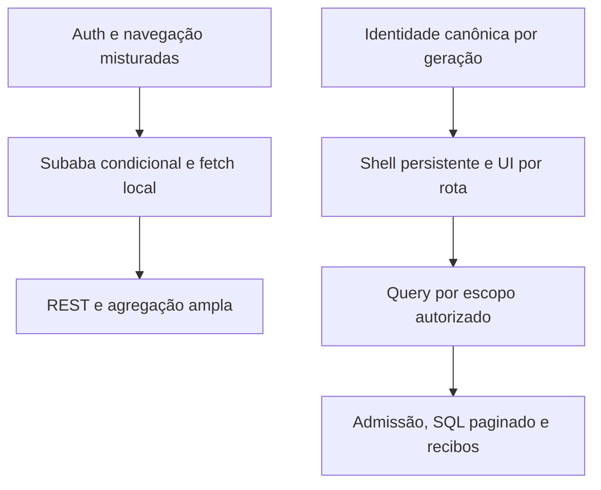

# Diagnóstico técnico — Backoffice Runtime V2
## Parecer
**NO-GO para promoção neste checkpoint.** A implementação controlada corrigiu os defeitos reproduzidos de permissão, remontagem, geometria e bootstrap; houve 30 casos PASSOU em Chromium e 30 em Firefox. Paridade de Produtividade, escritas concorrentes de Encerramentos/Defesa/Pagamentos/Liminares, imagem reproduzível e rollback foram executados. A regressão de domínio ampliada mantém sete falhas também reproduzidas na referência efetiva; não se declara o repositório inteiro verde. Isso não encerra a migração publicada: integração Microsoft real, validação autenticada do runtime publicado, configuração efetiva do pool, cobertura integral das demais operações e monitoramento após promoção permanecem sem evidência suficiente.

Nenhum deploy, parada, alteração do checkout vivo ou DDL de produção foi realizado. A autorização para interromper produção não substitui o gate técnico. O container publicado permaneceu c1c1645c…f16cc, iniciado em 22/10/2026; a revisão somente leitura de 25/10/2026 às 13h12 de Campo Grande encontrou **zero diferenças nos 166 paths comparados**. Assets publicados foram identificados como f0851b3.

## Causas confirmadas
| Achado | Evidência | Correção |
|---|---|---|
| Evento de auth compartilhava objeto e interceptor modificava tasks.view | A01 baseline falhou; perfil retornado divergiu de MBA_CURRENT_USER | Removida escrita em grants; ownership explícito e cópias imutáveis |
| Navegação externa redefinia subaba e desmontava conteúdo | A02 baseline falhou, DOM desapareceu | Guard de rota e keep-alive seletivo |
| Gate loadedKey/shown retirava cards durante consulta | A04/A05 baseline: zero slots, screenshots | Estrutura permanente; mesma chave mantém snapshot; chave diferente fica neutra |
| Encerramentos aguardava dependências lentas em conjunto | A13 com detalhe atrasado 15 s | Respostas independentes, estados locais de atualização/erro |
| Timeout transitório podia virar falsa tela de sessão encerrada | Fixtures 503/timeout e inspeção de bootstrap | Estado temporarily_unavailable, shell inerte, token preservado e orçamento único |
| Respostas antigas podiam atingir nova identidade | A11 e teste VM de 401 atrasado | Geração/token/escopo conferidos também na rejeição |
| Analytics ocupava capacidade crítica compartilhada | Benchmark de admissão com 30 pessoas + 10 analytics | Limite HTTP por worker e locks transacionais dos novos RPCs |
| Repetição de escrita após ACK perdido podia duplicar trabalho | Testes concorrentes e ACK perdido no HTTP/SQL | Intenção no cliente e recibo durável, sem retry cego |
| Evento de perfil podia anteceder o módulo de rascunhos | Falha real do CI em Processos | Reconciliação na carga e teste com bundle atrasado |
| Versão de acesso não cobria todas as restrições | Revisão de allowed_modules/access_kind/capabilities e testes de facetas | Versão/chave completas; nenhum grant ou critério de negócio alterado |

## Hipóteses e limites ainda abertos
- Não foi comprovada a origem dos timeouts publicados: fila no proxy/Gunicorn, pool/transporte e tempo de SQL não são intercambiáveis.
- Em uma rodada local da imagem 7aadb17, Regular/Admin recebeu 503 no resumo após 2.009 ms. A rodada terminou com 29 PASSOU/1 FALHOU. O reteste passou, com SQL em aproximadamente 116 ms; isso não explica a falha original. Gateway passou a registrar recebimento e conclusão upstream antes da entrega, e a API registra classe/tempo da tentativa falha, sem conteúdo sensível. O timeout não foi aumentado e não se declarou a causa resolvida.
- O máximo efetivo do pool PostgREST e eventual pre-request publicado não foram obtidos. Não foi sobrescrito um hook de segurança desconhecido. A admissão transacional protege os novos RPCs; analytics legado ainda tem limites HTTP.
- A amostra Nubank contém um evento. Nove combinações de papel/carteira foram testadas com identidades sintéticas; isso não certifica representatividade dos indicadores de Nubank.
- Não houve validação Microsoft em dois navegadores reais nem medição de autenticação/escrita publicada. Não foram criadas sessões por impersonação para contornar esse bloqueio.

## Arquitetura antes e depois

O estado visual pertence ao módulo; o servidor continua autoritativo para acesso e escrita. Cache não concede autorização. F5 reconstrói a UI e só hidrata resumo após validar identidade/carteira/grants. Mudança real de escopo invalida imediatamente; epoch de outro usuário não apaga o trabalho corrente.

## Implementação rastreável
Frontend: branch de trabalho dev/tasks-workspace; promoção isolada release/runtime-v2-20261024 baseada em f0851b3, sem levar alterações alheias do desenvolvimento. Código de facetas: a0a284d; orçamento global de retry: dec1b42; correções anteriores relevantes: dfad4c1, 96edb86, 257eb19.

Backend: migration/runtime-v2-reconciled-20261024. Código efetivo capturado na referência privada; commits e74657b (queries/recibos), bd32064 (corpus), 3ca2041 (contexto de build), 0eb988a (logs seguros), f8615e9 (facetas de acesso), b528a39 (falhas de transporte). Imagem final identifica o commit pelo label e por X-Runtime-Version; manifests e digests ficam na evidência privada. Referência de rollback: 01fe904.

| Área | Paths principais |
|---|---|
| Identidade/legado | auth.js, data-api.js, react-compat.js, config.js |
| Navegação/estado | src/tasks/TasksApp.tsx, qaDraft.ts, runtimeQueries.ts |
| Dados/geometry | src/tasks/TaskResults.tsx; src/dashboard/EncerramentosPage.tsx; dashboards adotados |
| Backend | routes/api/me.py, task_results.py; services/productivity_queries.py, runtime_v2.py, http_transport.py, write_intents.py |
| Banco | sete migrações geradas por CLI em supabase/migrations, apenas aplicadas no stage |
| Evidência/CI | tests/runtime-v2, tests/test_runtime_v2*, workflows de browser e backend |

## Testes executados e métricas
A matriz A01–A20 e B01–B06, com durações, commits e caminhos de evidência, está em [TEST-MATRIX.md](TEST-MATRIX.md). A01/A02/A04/A05 falharam no baseline atual; os registros dessas falhas permanecem.

- Browser final: 30/30 Chromium e 30/30 Firefox, sem erros de console/página. Regressão operacional de Processos em quatro viewports passou, inclusive F5 de rascunho legado e módulo carregado após auth.
- Paridade: 30 testes SQL, 5.025 combinações entre Python efetivo e SQL; três casos adicionais compararam células e formatação XLSX. Medianas, arredondamento, contagens, períodos, ordenação, CSV e ACL foram exercitados no escopo de Produtividade.
- Rodada final da imagem congelada: 43/43 testes HTTP/observabilidade/orçamento PASSOU em 21,79 s. Isso não apaga o 503 não induzido da rodada anterior.
- A suíte HTTP usa Gunicorn→SDK Supabase→gateway→PostgREST 14.5→PostgreSQL 17.11 reais. Identidades são sintéticas. Há testes de 10 salvamentos concorrentes, ACK perdido, finalização incerta, revogação e matriz de acesso.
- Reentrada selecionada: mediana 26,0 ms/P95 51,6 ms, sem fetch fresco. Após 46 s: exatamente uma revalidação com snapshot anterior visível.
- F5 com HTTP cache habilitado, n=8 quentes: shell até 266,1 ms; geometria até 327,2 ms; KPI após autorização até 445,6 ms. Fixture local; não é P95 de produção.
- Heap após GC: 12.036.864→12.459.836 bytes na amostra de 50 alternâncias; DOM/listeners/intervals estáveis. Não é certificação geral de ausência de leak.
- Benchmark final na mesma imagem congelada, com/sem admissão: 90 salvamentos finais; auth P95 3.105→196 ms; escrita P95 3.561→760 ms. São variantes da candidata com/sem admissão, não comparação completa com produção. 429 são reportados separadamente.
- O orçamento de identidade que chegou a 10,299 s em Firefox foi corrigido e retestado em 9,501/9,502 s. O teste não teve tolerância relaxada.

[BASELINE.md](BASELINE.md) define ambiente, denominadores, mediana/P95 e limitações. Os JSONs brutos preservam requests, cache hit/miss, payload bytes, shifts com/sem interação, long tasks e chamadas redundantes. Não se usou regex/build como prova principal.

## Evidência visual
Imagens abaixo contêm somente fixtures, sem documentos ou identidades reais.

Antes, durante atualização:

Depois, mesma chave com atualização lenta:

Traces completos são disponibilizados como artefatos do CI; screenshots e métricas selecionados estão versionados. Evidência autenticada real não é publicada no repositório público do frontend.

## Segurança e consistência
Foram revisados os caminhos de identidade/401, grants, escopo de query, snapshots, SQL/RPC, recibos e logs. Testes verificam bloqueio de RPC a anon/authenticated, carteira/papel, falhas de dependência, purga e respostas antigas. Nenhuma política de sessão única foi relaxada. Não se alteraram critérios de aptidão nem mediana por média.

Snapshot analítico contém somente quatro contagens, com TTL/esquema/checksum, e só aparece após autorização. Rascunhos operacionais têm política separada por usuário/carteira/recurso; não são usados como dados de servidor. Logs não contêm bearer, token_hash, nomes ou documentos. A revisão manual e testes focados não equivalem a uma certificação externa de segurança; o scanner formal não estava disponível.

## Regressões e recuperação
O CI encontrou problemas reais e problemas da fixture; cada um foi separado no MIGRATION_LOG. Não se restauraram funcionalidades antigas ausentes do runtime só para fazer pytest discovery passar. Não se publicou teste no Cloudflare.

O primeiro empacotamento com builder legado foi rejeitado por incluir metadados. O contexto final vem somente de git archive com allowlist; .git/.env/docs/tests/scripts foram conferidos como ausentes. Duas reconstruções produziram o mesmo digest. O rollback interno executou leitura/auth/escrita no candidato, na referência e novamente no candidato, com uma análise e um evento por operação.

[ROLLBACK.md](ROLLBACK.md) contém ordem de promoção, retenção do container/mounts, desativação de flags e conciliação de intenções processing/uncertain antes de voltar a código sem recibos. Não dropar journal nem repetir escrita incerta.

## Pendências que impedem encerramento
1. Validar identidade Microsoft e navegação/API publicadas com sessão legítima, sem fabricar sessão ou grants.
2. Fechar o diagnóstico de transporte/pool e discriminar fila real; a falha local não induzida permanece registrada.
3. Completar A15/A16: uploads, monitoramento assíncrono de Liminares e demais operações/indicadores ainda não certificados. Os fluxos finais de Encerramentos, Defesa, Pagamentos v2 e Liminares já têm integração HTTP/SQL controlada.
4. Validar operacionalmente o procedimento de [conciliação/retenção](WRITE-RECOVERY.md): ferramenta somente leitura testada, sem expiração ou limpeza automática nesta versão. Conciliação de incidente real não executada. Inventário confirmou o bind de arquivos e ausência de handles abertos para o SQLite conhecido.
5. Promover somente com gate aprovado e acompanhar por pelo menos duas horas. Esse monitoramento não ocorreu.

A autorização para prosseguir já foi dada. Não é necessária outra confirmação genérica para continuar trabalho local; autenticação segura do usuário e evidência dos gates são as dependências concretas restantes. Até lá, o parecer é **NO-GO**, e não “migração concluída”.

## Último gate de CI
Frontend dec1b42: [CI executado com sucesso](https://github.com/portilhooooooooo/mascarenhas.github.io/actions/runs/40217373556). Backend 65a7e92: [CI executado com sucesso](https://github.com/portilhooooooooo/mba-backoffice-backend/actions/runs/40220349776). O último ajuste compartilha uma única repetição entre handoff e perfil; oito retestes selecionados passaram em cada navegador, incluindo handoff 503 seguido de /me 503 sem retry adicional. Nenhum desses resultados equivale a integração Microsoft publicada.

## Correção do diagnóstico de acesso
O usuário confirmou que o login funcionou normalmente. A ocorrência “Failed to fetch” limitou-se à tentativa do agente de iniciar o fluxo na página pública da main, sem credenciais; não houve login nem sessão autenticada. Ela NÃO comprova falha do login da plataforma, de CORS, da Cloudflare ou da Microsoft. Retirada a classificação dessa ocorrência como bloqueio geral da integração.

O agente não dispõe de conta autorizada. Integração autenticada permanece NÃO EXECUTADA pelo agente por falta desse acesso, e não porque se tenha demonstrado indisponibilidade do serviço. A autorização de caminho não fornece credenciais nem permite fabricar sessão.

Login é permitido somente pelo fluxo de testes via executável .bat em local.portilhobackoffice.site, ou pela main publicada no Cloudflare. Não iniciar login diretamente na API nem usar origens alternativas. Não houve nova tentativa após a correção do usuário.

## Ampliação posterior de evidência controlada
Em 50a3cde, 59 testes HTTP/runtime/orçamento passaram em 22,26 s. Incluem três cenários de Pagamentos v2, Defesa, quatro decisões finais de Liminares modernas e seis legadas, replay após revogação e auditoria somente leitura. Contratos/triggers foram capturados por leitura e o inicializador foi executado em banco novo. Nenhuma regra de classificação foi substituída por mock SQL. As projeções de evidências e a FK nullable de upload têm limites explícitos nas fixtures. Não certificam upload, consulta externa ou fila de monitoramento.

A auditoria de recibos mostra apenas agregados e não libera comandos; todos os recibos são retidos nesta versão. Um evento de conclusão isolado não prova que todos os efeitos da intenção ocorreram. Ver WRITE-RECOVERY.md.

A sondagem CLI observou Cloudflare HTTP 403 com código 1010. Consulta somente leitura em 25/10/2026 18:10:22 UTC confirmou browser_check=on. Essa observação de CLI não comprova falha de acesso pelo navegador autorizado; o usuário confirmou login normal. A hipótese de bloqueio geral foi retirada. A origem publicada consta da configuração efetiva de frontend do container. Não houve retry de login nem alteração/bypass das proteções. A10 real e integração autenticada publicada continuam NÃO EXECUTADAS.

## Gate consolidado desta execução
- Backend 65a7e92: 65 casos HTTP/runtime/orçamento PASSOU em 25,25 s (JUnit: 25,247 s; início 25/10/2026 18:16:42 UTC). O XML registra duração por caso; final-65-execution.json associa teste, timestamp, commit e digest. CI remoto completo também PASSOU.
- Pagamentos legado: seis resultados autoritativos, com concorrência/replay, PASSOU em 3,58 s. Não houve duplicação de análise/evento.
- Dev/tasks-workspace: CI de browser e verificação React PASSOU em bf54945, incluindo o código final bd64022; não certificar somente a branch de promoção.
- Regressão adicional: 14 arquivos de domínio existentes, 97 testes e 90 subtests PASSOU, sete FALHOU. A mesma seleção contra a referência efetiva 01fe904 reproduziu exatamente os sete casos, sem diferença de resultados. Os cinco arquivos de regras comparados têm SHA-256 idêntico. Falhas e comparação permanecem em domain-candidate.log/xml, domain-reference.log/xml e domain-comparison.json no backend privado. Não foram corrigidas por mudança de regra ou por exclusão do relatório.

| Marco | Situação comprovada | O que impede fechamento integral |
|---|---|---|
| M0 | Reprodução e baseline controlados executados; código publicado inventariado | Baseline HTTP autenticado real não obtido |
| M1 | Segurança/auth controlados e sessões SQL testados | Microsoft real em dois navegadores não validado |
| M2 | DOM/estado/geometria e identidade visual testados em browsers | Não equivale a todas as jornadas publicadas |
| M3 | Query/TTL/snapshot/F5 autorizados testados | Hidratação autenticada publicada não validada |
| M4 | SQL de Produtividade, escritas adotadas, admissão e desacoplamento testados | Pool/transporte publicado; demais operações/indicadores e serviços externos |
| M5 | CI, browsers, SQL, carga controlada, imagem e rollback executados | Gate integral A15/A16 aberto; sete falhas pré-existentes registradas |
| M6 | NÃO EXECUTADO | Gate de promoção e monitoramento posterior de duas horas |

As sete falhas envolvem helper de projeção ausente no runtime capturado, expectativas de importação de Encerramentos, prazos de Defesa v4 e aceitação automática de indício insuficiente de Liminar. São divergências observadas entre testes existentes e runtime efetivo. Não há autorização técnica para trocar regras de negócio só para alinhá-los à main. O parecer permanece NO-GO.

## Encerramento diferido — cobertura adicional A15
Teste HTTP/SQL real na rede descartável: trânsito de 12 dias mantém processo waiting, análise nao_apto/prazo_pendente e reabertura em trânsito + 60 dias; seis chamadas concorrentes e replay produzem uma análise e um evento analysis_deferred, sem analysis_completed. Ver deferral.log/xml na evidência privada. Não altera regra de negócio nem apaga a falha do teste antigo que depende de helper ausente.
