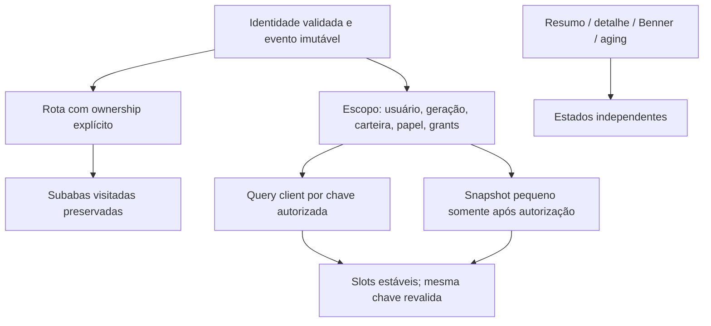

# Diagnóstico técnico Runtime V2 — candidato, NO-GO

Data local: 23/10/2026 (America/Campo_Grande). Evidências em UTC: 24/10/2026. Este relatório fecha o checkpoint executado, não declara concluída a migração nem resolvido o incidente em produção.

## Sumário executivo

O candidato corrige a mutação de permissões na ponte legada, separa navegação de autenticação, conserva subabas visitadas, mantém geometria durante consultas e restaura apenas agregados pequenos depois da autorização. Encerramentos publica suas dependências separadamente. O backend candidato tipa indisponibilidade transitória, acrescenta tempos/request_id, reduz repetição de validação e oferece admissão analítica opt-in. React/TypeScript/Vite, Python, visual e regras de negócio foram preservados.

Resultado executado: 20 subcasos Chromium passaram no build frontend e a suíte operacional do build real passou em quatro viewports. Backend: 59 testes passaram; os mesmos 59 passaram novamente na imagem reconstruída sem bind de código. Uma amostra real desidentificada passou em 1.125 comparações offline contra o fonte efetivo do container, sem divergência numérica compartilhada. Isso NÃO certifica integração real, novos agregados SQL, autorização no banco ou capacidade de produção.

Parecer: **NO-GO para promoção**. M0–M3 têm candidato e provas controladas; M4/M5 permanecem parciais; M6 não executado. Faltam reconciliação do runtime, SQL/paginação novos, paridade integral/exportações, tracing de fila/rede/SQL, carga equivalente com escrita durável, sessão real entre navegadores, idempotência completa, revisão de segurança e rollback operacional. Uma suíte legada de preview também falhou por contrato de payload desatualizado; o log foi conservado.

## Proveniência e ambientes

| Item | Revisão/ambiente |
|---|---|
| Frontend inicial | dev/tasks-workspace, 11a17cf58d2afcacbd90f2c92c7cd11591386793 |
| Frontend qualificado | e643f7bd747573de093f599ad367c8a56b0f6b6c |
| Frontend publicado investigado | auth.js com SHA igual ao main f0851b3; não promovido nesta execução |
| Backend live | container mba-backoffice-backend; imagem 64b00348da255b782262d780052a8339c704f18d0b1681c2b81cfc021c20225b |
| Label live | 89003b56662e0dcadc1dc7c6eebedcfeb7f7bc10; não representa integralmente o fonte em execução |
| Checkout operacional backend | main c2cb57d, alterações locais preservadas |
| Branch isolada backend | migration/runtime-v2-20261023; ac1f3f4 paginação, b7ba52b replay, 0d78860 evidências |
| Imagem de validação final | 4d536c772ead27270a656b032d08b240d77288704e415c9ffaf2eca50ce73343, fonte b7ba52b |
| Browser | Chromium Playwright, localhost no dispositivo autorizado; API interceptada |
| Backend tests | Container novo, rede desabilitada, 1 CPU/512 MiB, sem credenciais/env/portas de produção |
| Amostra real | SELECT limitado e somente leitura; replay offline, sem login de colaborador ou escrita |

Foram encontrados 43 caminhos Python de aplicação divergentes em relação à revisão declarada: 34 modificados e nove ausentes. São diferenças de proveniência, não 43 vulnerabilidades. O inventário de 275 caminhos rastreados não cobre todos os extras do runtime. Não foi misturado o checkout sujo à migração. Nenhum deploy, DDL ou edição do container vivo ocorreu.

## Causas confirmadas e hipóteses abertas

| Classificação | Evidência | Implicação |
|---|---|---|
| CONFIRMADA | react-compat escreve tasks.view no objeto detail compartilhado; A01 falha no replay | Navegação/loaders dependiam de mutação indevida de grant |
| CONFIRMADA | Rota externa redefine tab para execution e results era condicional | Produtividade desmontava apesar de conservar a raiz React |
| CONFIRMADA | shown dependia de chave/revisão e controlava existência das seções | Refresh/filtro retirava cards e tabelas |
| CONFIRMADA | Promise.all aguardava quatro endpoints em Encerramentos | Endpoint lento bloqueava publicação do resumo pronto |
| CONFIRMADA | Bootstrap transitório podia mostrar login com token ainda presente | 503 era apresentado como aparente encerramento |
| CONFIRMADA NA MIGRAÇÃO, CORRIGIDA | Evento de carteira iniciava /me antes da invalidação de época | A própria revalidação era descartada; 58c5704 corrige ordem; A11 passou |
| CONFIRMADA | Builder PostgREST mutável acumula offset/limit na implementação da branch | Três testes falharam antes, passaram após ac1f3f4; comportamento já existia no fonte efetivo |
| CONFIRMADA | 2 workers × 4 threads compartilhados e chamadas síncronas | Trabalho lento ocupa slots; ainda falta quantificar fila no tráfego real |
| ABERTA | Timeouts de REST/transporte/pool/gateway | Não há trace completo que atribua causa a Supabase, rede, VPS ou Python |
| ABERTA | Causa de cada logout histórico | Login novo pode substituir sessão; auditoria não prova o motivo de toda queda |
| ABERTA | Ganho real de SQL novo e isolamento de capacidade | Não há novo agregado SQL implementado nem teste equivalente de produção |
| ABERTA | Paridade integral e ordem de eventos empatados | Amostra offline pequena não certifica base completa nem ordenação live |

O bootstrap dev original usa cópia/proxy em parte do caminho e pode passar inicialmente. O ensaio A01 emite explicitamente o perfil compartilhado, contrato observado no auth.js publicado. Depois de A01, o baseline remove somente o interceptor na fixture para isolar ciclo de vida e renderização. Não se apresenta esse contrafactual como integração real.

## Arquitetura e alterações

Antes: identidade disparava loaders por grants alterados; rota externa redefinia subaba; dados controlavam existência da geometria; quatro dependências formavam uma barreira global.

A identidade tem initializing/authenticated/temporarily_unavailable/expired_or_revoked/forbidden. O shell com token fica inert enquanto valida; erro transitório conserva credencial sem conceder operação. Respostas antigas não revogam geração nova. Eventos entregam cópias congeladas; ativação de módulo usa evento próprio. Coordenação OAuth entre abas é inicial e não altera a política server-side de sessão única.

Keep-alive é seletivo em Execução/Atribuições/Produtividade; ocultos deixam de consultar. Filtro/ordenação/seleção/scroll sobrevivem às reentradas. Query keys contêm usuário não secreto, geração, carteira, papel, grants, filtros e contrato. Frescor de Produtividade: 45 s; resumos: 60 s. O servidor ainda não fornece versão explícita de política, uma limitação a resolver.

Snapshot em sessionStorage contém quatro agregados numéricos, schema/checksum/TTL 120 s/limite 4 KiB. Não contém listas, pessoas, tokens, documentos ou hashes de sessão. Quota/corrupção cai para busca. Só restaura após /me válido; mudança de escopo purga. Preferências de UI e rascunhos operacionais têm responsabilidade separada. Rascunhos v2 são isolados por usuário/carteira/tarefa/processo; v1 não é migrado automaticamente e exige revisão antes de promoção.

Mudanças de dados confirmadas invalidam queries relevantes; ocultas ficam stale. Não foi introduzido retry automático de writes nem confirmação fictícia. Caches legados e hidratação de várias páginas em Atribuições ainda existem: a camada única é incremental, não integral.

Backend mede app dentro de Flask e auth_dependency (RPC+transporte). Não chama esse tempo de SQL nem fila. O semáforo por processo é desativado por padrão; só reserva capacidade quando configurado abaixo das threads e validado. Não prova isolamento contra todos os endpoints concorrentes.

Commits e paths: [COMMITS.txt](COMMITS.txt), [CHANGED-PATHS.txt](CHANGED-PATHS.txt), [MIGRATION_LOG.md](MIGRATION_LOG.md). Contratos e responsabilidades: [SPEC.md](SPEC.md), [ARCHITECTURE.md](ARCHITECTURE.md).

## Medições antes/depois

Baseline: UTC 2026-10-24T01:46:35.468Z, 11a17cf. Qualificação: UTC 2026-10-24T03:05:07.783Z, e643f7b. Mesmo build real/browser e API controlada; a matriz final é mais ampla, por isso não se comparam totais globais de chamadas entre execuções.

| Medida/jornada | Antes | Depois | Limite da conclusão |
|---|---|---|---|
| A01 grants compartilhados | FALHOU | PASSOU | Evento reproduzido na fixture |
| A02/A03 conservar instância/estado | FALHOU | PASSOU | Retorno por menu/subaba real do build |
| A04/A05 quatro slots com atraso 15 s | Zero cards; FALHOU | Quatro cards; bounding box preservado no refetch | Trace/assert durante espera |
| A06 F5 filtro 7 | Voltava a 30; FALHOU | Mantém 7/ordem e resumo após autorização | Sem certificar SLO frio/quente |
| A08 503 sem falso login | FALHOU | PASSOU | Token conservado; ações bloqueadas |
| Retorno visitado, 50 medidas in-page | Não medido quantitativamente | Mediana 31,75 ms; P95 51,90 ms | Até animation frame, não latência API |
| Consultas repetidas dentro do frescor | Reentrada reconstruía e buscava | Zero novas consultas idênticas nos asserts | TTL controlado, não todos os módulos |
| KPI Encerramentos/detalhe 15 s | Barreira estática confirmada; tempo baseline não instrumentado | 381,84 ms | Fixture; não comparar à medição histórica |
| Heap observado, A18 | Não medido | 24,5 MB → 24,5 MB | Valor agregado do Chromium, sem GC controlado |
| Listeners A18 | Não medido | window 122→122; document 16→16; DOM conectado 702→702 | Após aquecimento |
| Timers/DOM A18 | Não medido | intervals 2→2; nós 2160→2160 | 50 reentradas, não prova de longa duração |
| Bootstrap com timeout | Sem orçamento unificado | Duas tentativas; estado indisponível observado ~10,89 s após início do documento | Deadline de 10 s inicia dentro da rotina; overhead do boot não separado |
| /me, gravação, analytics reais: mediana/P95 | Sem baseline equivalente atual | NÃO MEDIDO | Metas de produção PENDENTES |
| Shell ≤500 ms; FMP; payload bytes; CLS por jornada | Não medidos comparáveis | NÃO CERTIFICADOS | Telemetria atual é parcial |

PerformanceObserver captura long tasks e layout shifts, mas o relatório global final corresponde ao último documento/fluxo; não é um agregado comparável de toda a navegação. Não se afirma CLS zero. A04 verifica geometria durante refresh; não substitui análise de todos os shifts e telas. Tempos históricos misturavam sucesso/erro e não foram reutilizados como baseline.

## Testes e evidências

A tabela completa A01–A20 e B01–B06, com resultado integral/recorte, ações, duração e limites, está em [TEST-MATRIX.md](TEST-MATRIX.md). Resultados máquina: [qualified/metrics.json](evidence/qualified/metrics.json). A01–A20 não significa vinte critérios integrais certificados: há 20 subcasos e itens com integração faltante.

- Browser: 20/20 subcasos PASSARAM. Traces e screenshots têm timestamp/commit associado no JSON.
- Operacional: build real, quatro viewports (1366/1440/1920/390), Processos, paginação, timeline, criação explícita, Encerramento, permissão/erro/login e rascunho na navegação/F5: PASSOU.
- Backend: 59 PASSARAM em 4,39 s; imagem reconstruída sem bind: 59 PASSARAM em 3,36 s.
- Paridade real offline: 1.125 casos, zero diferenças numéricas compartilhadas; replay reconstruído em 1,311 s.
- Smoke/unit frontend: test:hardening e dez testes API/Base Geral/acesso PASSARAM; auxiliares de sessão/papel/encerramentos/Metabase passaram na execução registrada.
- Preview legado test:ux: FALHOU, pois espera {decision,notes} e o renderer atual envia {agree,answers}; o renderer não foi modificado pela migração. Não é prova de integração nem falha silenciosamente descartada.
- CI hospedado: Runtime V2 frontend (20 subcasos + operacional), React Migration, Base Geral e backend (59 testes + benchmark + replay) PASSARAM. Execuções 40057583540/40057583475/40057583409 e 40057335445; commits e steps em [CI_RESULTS.json](evidence/CI_RESULTS.json). Backend CI: 59 em 2,27 s.
- Firefox, integração autenticada real, carga completa, revisão formal de segurança e duas horas de produção: NÃO EXECUTADOS/certificados.

[Antes A04](evidence/baseline-repeat/A04.png) e [depois A04](evidence/qualified/A04.png) foram inspecionados visualmente. Layout, sidebar, tipografia, cor e ordem permanecem; slots/status neutros são as mudanças permitidas. Os screenshots ilustram estados; os asserts e o trace registram a espera, pois o screenshot final de um teste pode ocorrer após a resposta.

## Carga, perfis e paridade

O benchmark sintético em dois executores de quatro threads, dez analytics de 150 ms e trinta operações críticas teve mediana/P95 críticos 247,54/256,24 ms antes e 12,28/21,95 ms depois. Quatro analytics 200 e seis 429; trinta críticos 200. Isso demonstra admissão no modelo, não B04 completo: não há proxy, rede HTTP, banco, sessão ou escrita durável.

A amostra real offline abrange Admin/Legal Leader/Analista e Enter/Regular/Nubank, cinco períodos/prazos/faixas de duração: 375 casos por carteira. Enter teve 66 casos com amostras temporais e Regular 40; Nubank não tinha medição temporal no recorte, portanto sua mediana não foi validada com valor não nulo. Pendências, exports, coortes de Encerramentos e novos SQL permanecem pendentes. [PARIDADE.md](PARIDADE.md) detalha método/exclusões; dados completos permanecem na branch privada backend.

## Riscos residuais e próximo gate

1. Reconciliar a imagem, os 43 caminhos divergentes e extras do container com um commit reproduzível; não substituir a árvore operacional pelo baseline da branch.
2. Criar e validar endpoints separados de resumo/detalhe/export, com agregação/paginação autorizada no banco e mediana exata; comparar bases/coortes/exports e planos antes de índices.
3. Provisionar ambiente equivalente e identidade técnica de teste, sem reutilizar sessões de colaboradores, para B01–B06, acesso real e carga 30+10 com gravações idempotentes.
4. Correlacionar proxy/fila/Gunicorn/auth/transporte/PostgREST/SQL; resolver orçamento server-side, repetir medições separando sucesso/erro e frio/quente.
5. Completar coordenação OAuth/Admin entre navegadores, auditoria de revogação, revisão dos rascunhos v1 e caches/polling ainda legados; revisar retry de handoff herdado.
6. Alinhar a suíte legada ao contrato vigente, manter os checks CI aprovados e executar revisão formal de segurança. A skill de scan não pôde executar: preflight referenciado indisponível e ferramentas de scan ausentes.
7. Só então solicitar promoção expressa, realizar rollback ensaiado e observar por duas horas.

Rollback e comandos locais: [ROLLBACK.md](ROLLBACK.md), [RUN_LOCAL.md](RUN_LOCAL.md). Não houve migração de schema nem dados a reverter nesta fase. Os candidatos estão em branches de teste; produção não foi promovida.
