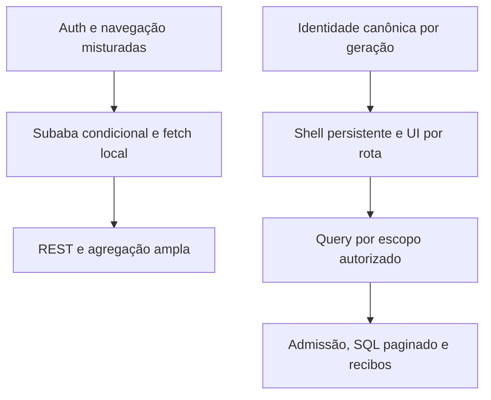
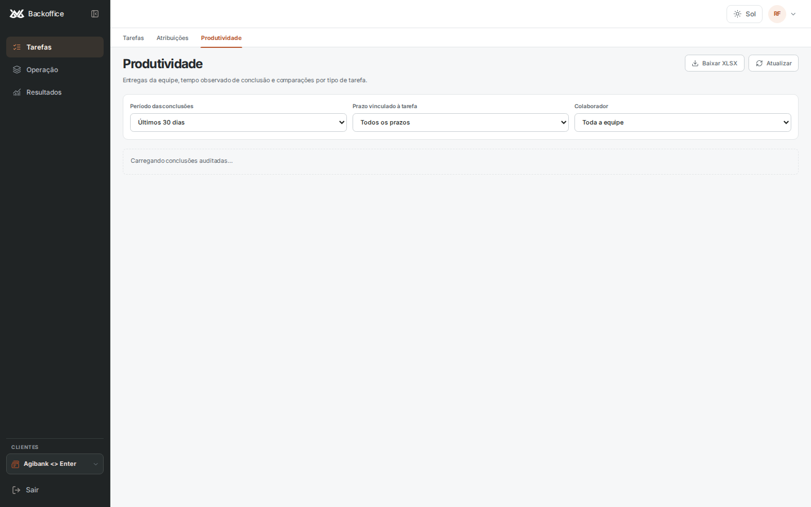
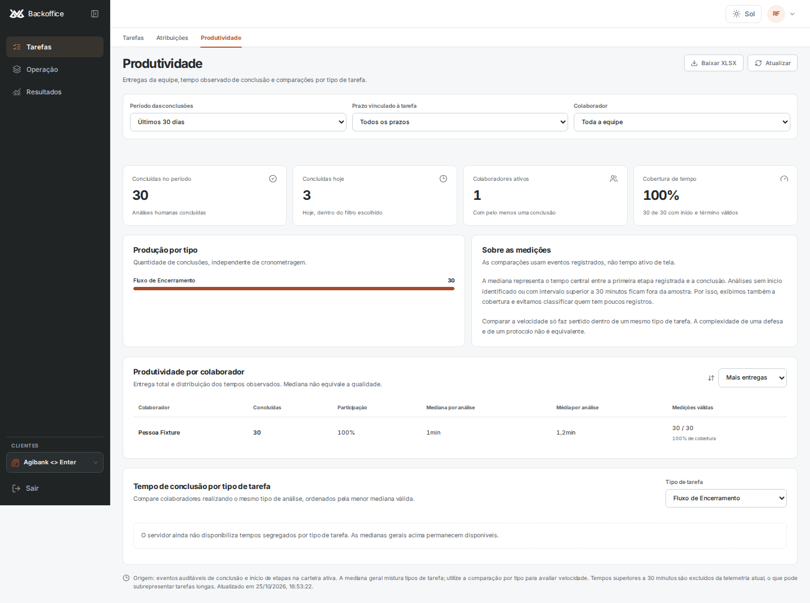

# Diagnóstico técnico — Backoffice Runtime V2

## Checkpoint adicional — atomicidade de Encerramentos, 25/10/2026
**Parecer atual: NO-GO.** Nova candidata de aplicação 14503a1, SQL/testes 581b8e1. Este checkpoint passa a registrar quatro falhas de domínio restantes; os números anteriores abaixo são históricos. Os CIs finais do checkpoint anterior (release 69fb5ea, backend 9a9f5fc) concluíram com sucesso.

### Defeito reproduzido e correção
A gravação de Encerramentos tinha fronteiras de transação separadas. Com payload V5 válido e falha SQL controlada:
- erro ao inserir evento de adiamento: análise persistida, status alterado, evento ausente;
- erro ao atualizar metadados de adiamento: análise persistida, status anterior, evento ausente;
- erro ao atualizar metadados de conclusão: análise persistida, status concluído e evento já persistido, metadados ausentes.
A falha no evento de conclusão já fazia rollback pela RPC antiga: o quarto cenário era e continua correto.

A função nova runtime_v2_save_closing reúne essas etapas na mesma transação e bloqueia a linha do processo. Na conclusão, chama a auth_save_analysis efetiva, preservando seus checks/regras; no adiamento, preserva as mesmas condições da rota atual. Carteira é vinculada pelo proxy de escopo e conferida em SQL. EXECUTE segue restrito ao backend. Metadados alheios são preservados, e raiz inválida recebe a mesma normalização do legado. **Não mudaram classificações, prazo de 60 dias, perfis ou grants.**

Implementação atrás de RUNTIME_V2_CLOSING_ATOMIC=1, habilitada somente no stage. Oitava migração: 20261025233600_runtime_v2_atomic_closing_save.sql. Não houve aplicação SQL ou deploy de produção. Recibo pode permanecer uncertain após erro de transporte: não se presume rollback só porque houve 503 e não se habilita retry cego.

### Evidência executada
- Suíte HTTP/runtime/orçamento: **126 PASSOU em 46,35 s**. Mais cinco casos de segurança SQL PASSOU; mais três casos de metadados inválidos PASSOU (junto de 18 casos de escopo repetidos). Total de **134 casos distintos aprovados**, sem somar retestes duplicados.
- Casos focados: 25 PASSOU, incluindo quatro falhas transacionais, matriz de 18 combinações papel/carteira × conclusão/adiamento, replay e duas negações de RPC para browser. Nas falhas, análise/status/metadados/evento voltam integralmente ao estado anterior.
- Cinco negações SQL: carteira divergente, ator não atribuído, perfil bloqueado e campos inesperados em valores/metadados; nenhuma gravação.
- Regressão ampliada: **100 testes e 90 subtests PASSOU; quatro FALHOU**. Um teste de adiamento não chegava aos asserts porque mockava closing_projection ausente no runtime. Apenas esse mock foi retirado; todos os asserts originais passaram. Permanecem criação genérica sem responsável, dois contratos de prazos de Defesa e concordância automática em Liminar sem evidência suficiente. Nenhum assert foi afrouxado para ocultar essas divergências.
- Chromium e Firefox: A13 e A15-write-intent PASSOU, sem erro JS/console. Respostas são fixtures de browser; integração HTTP/SQL é a prova separada descrita acima.
- Build da imagem 14503a1 reproduzido: sha256:c7109322a6fe84ca6ef8b722feb25ddc9f808db936d89f54d47add6e63d19afd. A versão SQL 581b8e1 é identificada separadamente por hash. Banco vazio reconstruído com essa versão.
- Rollback candidata → referência efetiva 01fe904 → candidata: leitura/auth 200, gravação/importação 201 e contagens únicas. Migrações aditivas mantidas no ensaio.

A primeira fixture de adiamento misturava campos de versões e retornou 400. Foi corrigida antes de usar os resultados como evidência: os arquivos before-valid/valid-after contêm o payload válido. Os resultados iniciais inválidos foram preservados e explicitamente separados em closing-atomic-execution.json. Não são reprodução do defeito.

### Carga na nova imagem, stage somente
Três rodadas com 30 colaboradores sintéticos + 10 analytics, SQL atrasado 1,5 s. A mesma imagem atômica foi usada nas variantes com/sem admissão. Portanto a comparação abaixo mede admissão, não o efeito isolado de atomicidade.

| Fluxo | n antes/depois | Mediana antes/depois (ms) | P95 antes/depois (ms) |
|---|---:|---:|---:|
| Validação de sessão | 45 / 45 | 1694,2 / 95,3 | 3104,5 / 226,2 |
| Gravação final | 45 / 45 | 2021,1 / 417,1 | 3441,9 / 619,0 |
| Analytics com sucesso | 30 / 12 | 1670,5 / 1581,8 | 4614,3 / 1590,9 |

Novamente 90/90 gravações confirmadas. Analytics: 12 respostas 200 + 18 respostas 429 na candidata; rejeições não contam na distribuição de sucesso. Não houve carga em produção.

A15 integral, A16 integral, correlação real/pool de B03, validação autenticada legítima e M6 com monitoramento permanecem pendentes. A migração não está concluída nem promovida. Evidências privadas em evidence/final-controlled/closing-atomic-* e screenshots/metrics públicos em evidence/closing-atomic-chromium e evidence/closing-atomic-firefox.

## Checkpoint de 25/10/2026 — importação atômica e criação por Processos

**Parecer atual: NO-GO para promoção.** Este checkpoint substitui os totais anteriores, preservados abaixo como histórico. Fonte candidata: backend 25bb6c1; testes adicionais ce9a4ce. Frontend: release ce569da e dev 4324990, sem nova mudança de layout/aplicação neste checkpoint.

### Correções e provas executadas

- **Importação de Encerramentos (634d862):** o Python criava upload/processos via RPC e só depois aplicava as classificações por PATCH. Uma falha controlada nesse PATCH devolveu 503, mas deixou um upload e três processos sem classificação. A função SQL já publicada aceita a classificação na mesma transação. A candidata passou a enviá-la nessa chamada, preservando parser, filtros, distribuição e critérios. Nenhum DDL de produção foi necessário ou aplicado.
- CSV e XLSX: três linhas válidas e duas rejeitadas, classificações e responsáveis exatos, um upload/evento; repetição devolve 409 e não duplica. Falha SQL interna desfaz upload/processos/eventos. Perfil, responsável e carteira indevidos são rejeitados; RPCs continuam exclusivos do backend, sem EXECUTE para anon/authenticated.
- **Criação pelo módulo Processos (25bb6c1):** o formulário ativo envia process_cnj; a referência capturada rejeitou o contrato com 422. Foi reconciliado apenas esse caminho já existente em main, usando processos_create_task já publicado. Validação de CNJ, carteira, responsável e permissão precede a transação; não foram importadas as demais mudanças de política de criação/atribuição de main.
- **22 casos do fluxo Processos PASSOU:** nove combinações de Liminar/Defesa/Encerramento × Enter/Regular/Nubank, onze rejeições/falhas transacionais e duas negações de RPC direto. O diretório do stage é uma projeção sintética mínima de existência: não certifica sincronização ou indicadores de Processos.
- **Suíte HTTP/runtime/orçamento: 102 PASSOU em 51,57 s.** Gunicorn → cliente Supabase → PostgREST → PostgreSQL reais dentro do stage, com identidades sintéticas. O teste sem opt-in falha antes de executar o corpo; alvos HTTP e banco são limitados ao ambiente descartável.
- **Regressão ampliada: 99 testes e 90 subtests PASSOU; cinco FALHOU.** As duas falhas de importação CSV/XLSX anteriores foram corrigidas. Os demais resultados ficaram idênticos, inclusive após a correção de Processos. Restam: referência de teste a closing_projection ausente; criação genérica sem responsável; dois contratos de prazos de Defesa; concordância automática em Liminar sem evidência suficiente. Não se alterou regra de negócio para tornar esses testes verdes.
- Imagem de 25bb6c1 reconstruída com o mesmo digest **sha256:726fbb1591fe505f8c8ae41c61151f4e65e98f35b0c4ed95978b55cfee7f05c9**. Candidata → referência efetiva 01fe904 → candidata: auth/leitura 200 e gravação 201, uma análise/evento; importação de arquivo também 201, duas classificações corretas e um evento em cada variante. O rollback restaura o comportamento anterior, inclusive limitações conhecidas; não certifica que a referência aceite process_cnj.

### Nova carga controlada na imagem 634d862

Três rodadas, 30 colaboradores sintéticos + 10 aberturas de analytics por rodada, SQL atrasado 1,5 s, Gunicorn 2 × 4. Variantes da mesma imagem com/sem admissão. Resultados de 25/10 às 22h44 UTC, sem tráfego em produção:

| Fluxo | n por variante | Mediana antes/depois (ms) | P95 antes/depois (ms) |
|---|---:|---:|---:|
| Validação de sessão | 45 | 3031,8 / 79,5 | 3135,2 / 118,5 |
| Gravação final | 45 | 2193,0 / 425,3 | 3508,4 / 680,3 |
| Analytics com sucesso | 30 / 12 | 1659,2 / 1575,9 | 4636,7 / 1590,1 |

Houve 18 respostas 429 de admissão na candidata e 12 respostas 200; os 429 não foram misturados à distribuição de sucesso. Todas as 90 gravações finais esperadas foram encontradas no banco. Esses números são do stage e da imagem 634d862; não foram atribuídos à imagem posterior 25bb6c1 nem ao runtime publicado. Não houve teste de carga de produção.

### Browser, CI e limites

O inventário com Playwright confirmou que um modal React antigo não é alcançável pelo fluxo atual. Não se redesenhou a interface com base nesse código morto. Screenshot/inventory.json em evidence/upload-controls registram o estado real do build com identidade fixture; não são certificação de upload concluído pela UI.

Uma rodada histórica do Firefox (run 40224116675, fonte 121a6e0) fechou página/contexto inesperadamente após A15-write-intent. A causa continua aberta. Acrescentaram-se eventos de crash/close/disconnect e DEBUG=pw:browser no CI, sem retries ou afrouxamento de asserts. A injeção explícita de fechamento prova a captura do erro, não reproduz a causa histórica. A15-write-intent e A11-handoff-same-user passaram em Firefox nas duas branches. CIs de ce569da (40241489835), dev 4324990 (40241491634) e backend 25bb6c1 (40242549216) passaram.

**Pendências de promoção:** cinco falhas de domínio precisam de resolução contratual; A15 integral (todos os writes, retomada de upload e workers); A16 integral e representatividade Nubank; B03 com correlação real e configuração do pool; validação autenticada legítima via .bat/local ou main; conciliação operacional de recibos em incidente; M6 com deploy rastreável e duas horas de monitoramento. Não houve login do agente, deploy, parada, alteração do checkout vivo ou DDL de produção. A hipótese de indisponibilidade geral do login permanece retirada, conforme o login bem-sucedido informado pelo usuário.

Evidências completas do backend estão em evidence/final-controlled: upload-execution.json, upload-full-80.log/xml, upload-before.log/xml, domain-atomic.log/xml, linked-execution.json, linked-full.log/xml, linked-negative.log/xml, domain-linked.log/xml, upload-load.json e linked-rollback.json, com hashes no MANIFEST privado. Os testes controlados não substituem integração autenticada publicada.

## Parecer
**NO-GO para promoção neste checkpoint.** A implementação controlada corrigiu os defeitos reproduzidos de permissão, remontagem, geometria e bootstrap; houve 30 casos PASSOU em Chromium e 30 em Firefox. Paridade de Produtividade, escritas concorrentes de Encerramentos/Defesa/Pagamentos/Liminares, imagem reproduzível e rollback foram executados. A regressão de domínio ampliada mantém cinco falhas pré-existentes após corrigir duas de importação; não se declara o repositório inteiro verde. Isso não encerra a migração publicada: integração Microsoft real, validação autenticada do runtime publicado, configuração efetiva do pool, cobertura integral das demais operações e monitoramento após promoção permanecem sem evidência suficiente.

Nenhum deploy, parada, alteração do checkout vivo ou DDL de produção foi realizado. A autorização para interromper produção não substitui o gate técnico. O container publicado permaneceu c1c1645c…f16cc, iniciado em 22/10/2026; a revisão somente leitura de 25/10/2026 às 13h12 de Campo Grande encontrou **zero diferenças nos 166 paths comparados**. Assets publicados foram identificados como f0851b3.

## Causas confirmadas
| Achado | Evidência | Correção |
|---|---|---|
| Evento de auth compartilhava objeto e interceptor modificava tasks.view | A01 baseline falhou; perfil retornado divergiu de MBA_CURRENT_USER | Removida escrita em grants; ownership explícito e cópias imutáveis |
| Navegação externa redefinia subaba e desmontava conteúdo | A02 baseline falhou, DOM desapareceu | Guard de rota e keep-alive seletivo |
| Gate loadedKey/shown retirava cards durante consulta | A04/A05 baseline: zero slots, screenshots | Estrutura permanente; mesma chave mantém snapshot; chave diferente fica neutra |
| Encerramentos aguardava dependências lentas em conjunto | A13 com detalhe atrasado 15 s | Respostas independentes, estados locais de atualização/erro |
| Timeout transitório podia virar falsa tela de sessão encerrada | Fixtures 503/timeout e inspeção de bootstrap | Estado temporarily_unavailable, shell inerte, token preservado e orçamento único |
| Respostas antigas podiam atingir nova identidade | A11 e teste VM de 401 atrasado | Geração/token/escopo conferidos também na rejeição |
| Analytics ocupava capacidade crítica compartilhada | Benchmark de admissão com 30 pessoas + 10 analytics | Limite HTTP por worker e locks transacionais dos novos RPCs |
| Repetição de escrita após ACK perdido podia duplicar trabalho | Testes concorrentes e ACK perdido no HTTP/SQL | Intenção no cliente e recibo durável, sem retry cego |
| Evento de perfil podia anteceder o módulo de rascunhos | Falha real do CI em Processos | Reconciliação na carga e teste com bundle atrasado |
| Versão de acesso não cobria todas as restrições | Revisão de allowed_modules/access_kind/capabilities e testes de facetas | Versão/chave completas; nenhum grant ou critério de negócio alterado |

## Hipóteses e limites ainda abertos
- Não foi comprovada a origem dos timeouts publicados: fila no proxy/Gunicorn, pool/transporte e tempo de SQL não são intercambiáveis.
- Em uma rodada local da imagem 7aadb17, Regular/Admin recebeu 503 no resumo após 2.009 ms. A rodada terminou com 29 PASSOU/1 FALHOU. O reteste passou, com SQL em aproximadamente 116 ms; isso não explica a falha original. Gateway passou a registrar recebimento e conclusão upstream antes da entrega, e a API registra classe/tempo da tentativa falha, sem conteúdo sensível. O timeout não foi aumentado e não se declarou a causa resolvida.
- O máximo efetivo do pool PostgREST e eventual pre-request publicado não foram obtidos. Não foi sobrescrito um hook de segurança desconhecido. A admissão transacional protege os novos RPCs; analytics legado ainda tem limites HTTP.
- A amostra Nubank contém um evento. Nove combinações de papel/carteira foram testadas com identidades sintéticas; isso não certifica representatividade dos indicadores de Nubank.
- Não houve validação Microsoft em dois navegadores reais nem medição de autenticação/escrita publicada. Não foram criadas sessões por impersonação para contornar esse bloqueio.

## Arquitetura antes e depois

O estado visual pertence ao módulo; o servidor continua autoritativo para acesso e escrita. Cache não concede autorização. F5 reconstrói a UI e só hidrata resumo após validar identidade/carteira/grants. Mudança real de escopo invalida imediatamente; epoch de outro usuário não apaga o trabalho corrente.

## Implementação rastreável
Frontend: branch de trabalho dev/tasks-workspace; promoção isolada release/runtime-v2-20261024 baseada em f0851b3, sem levar alterações alheias do desenvolvimento. Código de facetas: a0a284d; orçamento global de retry: dec1b42; correções anteriores relevantes: dfad4c1, 96edb86, 257eb19.

Backend: migration/runtime-v2-reconciled-20261024. Código efetivo capturado na referência privada; commits e74657b (queries/recibos), bd32064 (corpus), 3ca2041 (contexto de build), 0eb988a (logs seguros), f8615e9 (facetas de acesso), b528a39 (falhas de transporte). Imagem final identifica o commit pelo label e por X-Runtime-Version; manifests e digests ficam na evidência privada. Referência de rollback: 01fe904.

| Área | Paths principais |
|---|---|
| Identidade/legado | auth.js, data-api.js, react-compat.js, config.js |
| Navegação/estado | src/tasks/TasksApp.tsx, qaDraft.ts, runtimeQueries.ts |
| Dados/geometry | src/tasks/TaskResults.tsx; src/dashboard/EncerramentosPage.tsx; dashboards adotados |
| Backend | routes/api/me.py, task_results.py; services/productivity_queries.py, runtime_v2.py, http_transport.py, write_intents.py |
| Banco | sete migrações geradas por CLI em supabase/migrations, apenas aplicadas no stage |
| Evidência/CI | tests/runtime-v2, tests/test_runtime_v2*, workflows de browser e backend |

## Testes executados e métricas
A matriz A01–A20 e B01–B06, com durações, commits e caminhos de evidência, está em [TEST-MATRIX.md](TEST-MATRIX.md). A01/A02/A04/A05 falharam no baseline atual; os registros dessas falhas permanecem.

- Browser final: 30/30 Chromium e 30/30 Firefox, sem erros de console/página. Regressão operacional de Processos em quatro viewports passou, inclusive F5 de rascunho legado e módulo carregado após auth.
- Paridade: 30 testes SQL, 5.025 combinações entre Python efetivo e SQL; três casos adicionais compararam células e formatação XLSX. Medianas, arredondamento, contagens, períodos, ordenação, CSV e ACL foram exercitados no escopo de Produtividade.
- Rodada final da imagem congelada: 43/43 testes HTTP/observabilidade/orçamento PASSOU em 21,79 s. Isso não apaga o 503 não induzido da rodada anterior.
- A suíte HTTP usa Gunicorn→SDK Supabase→gateway→PostgREST 14.5→PostgreSQL 17.11 reais. Identidades são sintéticas. Há testes de 10 salvamentos concorrentes, ACK perdido, finalização incerta, revogação e matriz de acesso.
- Reentrada selecionada: mediana 26,0 ms/P95 51,6 ms, sem fetch fresco. Após 46 s: exatamente uma revalidação com snapshot anterior visível.
- F5 com HTTP cache habilitado, n=8 quentes: shell até 266,1 ms; geometria até 327,2 ms; KPI após autorização até 445,6 ms. Fixture local; não é P95 de produção.
- Heap após GC: 12.036.864→12.459.836 bytes na amostra de 50 alternâncias; DOM/listeners/intervals estáveis. Não é certificação geral de ausência de leak.
- Benchmark final na mesma imagem congelada, com/sem admissão: 90 salvamentos finais; auth P95 3.105→196 ms; escrita P95 3.561→760 ms. São variantes da candidata com/sem admissão, não comparação completa com produção. 429 são reportados separadamente.
- O orçamento de identidade que chegou a 10,299 s em Firefox foi corrigido e retestado em 9,501/9,502 s. O teste não teve tolerância relaxada.

[BASELINE.md](BASELINE.md) define ambiente, denominadores, mediana/P95 e limitações. Os JSONs brutos preservam requests, cache hit/miss, payload bytes, shifts com/sem interação, long tasks e chamadas redundantes. Não se usou regex/build como prova principal.

## Evidência visual
Imagens abaixo contêm somente fixtures, sem documentos ou identidades reais.

Antes, durante atualização:

Depois, mesma chave com atualização lenta:

Traces completos são disponibilizados como artefatos do CI; screenshots e métricas selecionados estão versionados. Evidência autenticada real não é publicada no repositório público do frontend.

## Segurança e consistência
Foram revisados os caminhos de identidade/401, grants, escopo de query, snapshots, SQL/RPC, recibos e logs. Testes verificam bloqueio de RPC a anon/authenticated, carteira/papel, falhas de dependência, purga e respostas antigas. Nenhuma política de sessão única foi relaxada. Não se alteraram critérios de aptidão nem mediana por média.

Snapshot analítico contém somente quatro contagens, com TTL/esquema/checksum, e só aparece após autorização. Rascunhos operacionais têm política separada por usuário/carteira/recurso; não são usados como dados de servidor. Logs não contêm bearer, token_hash, nomes ou documentos. A revisão manual e testes focados não equivalem a uma certificação externa de segurança; o scanner formal não estava disponível.

## Regressões e recuperação
O CI encontrou problemas reais e problemas da fixture; cada um foi separado no MIGRATION_LOG. Não se restauraram funcionalidades antigas ausentes do runtime só para fazer pytest discovery passar. Não se publicou teste no Cloudflare.

O primeiro empacotamento com builder legado foi rejeitado por incluir metadados. O contexto final vem somente de git archive com allowlist; .git/.env/docs/tests/scripts foram conferidos como ausentes. Duas reconstruções produziram o mesmo digest. O rollback interno executou leitura/auth/escrita no candidato, na referência e novamente no candidato, com uma análise e um evento por operação.

[ROLLBACK.md](ROLLBACK.md) contém ordem de promoção, retenção do container/mounts, desativação de flags e conciliação de intenções processing/uncertain antes de voltar a código sem recibos. Não dropar journal nem repetir escrita incerta.

## Pendências que impedem encerramento
1. Validar identidade Microsoft e navegação/API publicadas com sessão legítima, sem fabricar sessão ou grants.
2. Fechar o diagnóstico de transporte/pool e discriminar fila real; a falha local não induzida permanece registrada.
3. Completar A15/A16: uploads, monitoramento assíncrono de Liminares e demais operações/indicadores ainda não certificados. Os fluxos finais de Encerramentos, Defesa, Pagamentos v2 e Liminares já têm integração HTTP/SQL controlada.
4. Validar operacionalmente o procedimento de [conciliação/retenção](WRITE-RECOVERY.md): ferramenta somente leitura testada, sem expiração ou limpeza automática nesta versão. Conciliação de incidente real não executada. Inventário confirmou o bind de arquivos e ausência de handles abertos para o SQLite conhecido.
5. Promover somente com gate aprovado e acompanhar por pelo menos duas horas. Esse monitoramento não ocorreu.

A autorização para prosseguir já foi dada. Não é necessária outra confirmação genérica para continuar trabalho local; autenticação segura do usuário e evidência dos gates são as dependências concretas restantes. Até lá, o parecer é **NO-GO**, e não “migração concluída”.

## Último gate de CI
Frontend dec1b42: [CI executado com sucesso](https://github.com/portilhooooooooo/mascarenhas.github.io/actions/runs/40217373556). Backend 65a7e92: [CI executado com sucesso](https://github.com/portilhooooooooo/mba-backoffice-backend/actions/runs/40220349776). O último ajuste compartilha uma única repetição entre handoff e perfil; oito retestes selecionados passaram em cada navegador, incluindo handoff 503 seguido de /me 503 sem retry adicional. Nenhum desses resultados equivale a integração Microsoft publicada.

## Correção do diagnóstico de acesso
O usuário confirmou que o login funcionou normalmente. A ocorrência “Failed to fetch” limitou-se à tentativa do agente de iniciar o fluxo na página pública da main, sem credenciais; não houve login nem sessão autenticada. Ela NÃO comprova falha do login da plataforma, de CORS, da Cloudflare ou da Microsoft. Retirada a classificação dessa ocorrência como bloqueio geral da integração.

O agente não dispõe de conta autorizada. Integração autenticada permanece NÃO EXECUTADA pelo agente por falta desse acesso, e não porque se tenha demonstrado indisponibilidade do serviço. A autorização de caminho não fornece credenciais nem permite fabricar sessão.

Login é permitido somente pelo fluxo de testes via executável .bat em local.portilhobackoffice.site, ou pela main publicada no Cloudflare. Não iniciar login diretamente na API nem usar origens alternativas. Não houve nova tentativa após a correção do usuário.

## Ampliação posterior de evidência controlada
Em 50a3cde, 59 testes HTTP/runtime/orçamento passaram em 22,26 s. Incluem três cenários de Pagamentos v2, Defesa, quatro decisões finais de Liminares modernas e seis legadas, replay após revogação e auditoria somente leitura. Contratos/triggers foram capturados por leitura e o inicializador foi executado em banco novo. Nenhuma regra de classificação foi substituída por mock SQL. As projeções de evidências e a FK nullable de upload têm limites explícitos nas fixtures. Não certificam upload, consulta externa ou fila de monitoramento.

A auditoria de recibos mostra apenas agregados e não libera comandos; todos os recibos são retidos nesta versão. Um evento de conclusão isolado não prova que todos os efeitos da intenção ocorreram. Ver WRITE-RECOVERY.md.

A sondagem CLI observou Cloudflare HTTP 403 com código 1010. Consulta somente leitura em 25/10/2026 18:10:22 UTC confirmou browser_check=on. Essa observação de CLI não comprova falha de acesso pelo navegador autorizado; o usuário confirmou login normal. A hipótese de bloqueio geral foi retirada. A origem publicada consta da configuração efetiva de frontend do container. Não houve retry de login nem alteração/bypass das proteções. A10 real e integração autenticada publicada continuam NÃO EXECUTADAS.

## Gate consolidado desta execução
- Backend 65a7e92: 65 casos HTTP/runtime/orçamento PASSOU em 25,25 s (JUnit: 25,247 s; início 25/10/2026 18:16:42 UTC). O XML registra duração por caso; final-65-execution.json associa teste, timestamp, commit e digest. CI remoto completo também PASSOU.
- Pagamentos legado: seis resultados autoritativos, com concorrência/replay, PASSOU em 3,58 s. Não houve duplicação de análise/evento.
- Dev/tasks-workspace: CI de browser e verificação React PASSOU em bf54945, incluindo o código final bd64022; não certificar somente a branch de promoção.
- Regressão adicional: 14 arquivos de domínio existentes, 97 testes e 90 subtests PASSOU, sete FALHOU. A mesma seleção contra a referência efetiva 01fe904 reproduziu exatamente os sete casos, sem diferença de resultados. Os cinco arquivos de regras comparados têm SHA-256 idêntico. Falhas e comparação permanecem em domain-candidate.log/xml, domain-reference.log/xml e domain-comparison.json no backend privado. Não foram corrigidas por mudança de regra ou por exclusão do relatório.

| Marco | Situação comprovada | O que impede fechamento integral |
|---|---|---|
| M0 | Reprodução e baseline controlados executados; código publicado inventariado | Baseline HTTP autenticado real não obtido |
| M1 | Segurança/auth controlados e sessões SQL testados | Microsoft real em dois navegadores não validado |
| M2 | DOM/estado/geometria e identidade visual testados em browsers | Não equivale a todas as jornadas publicadas |
| M3 | Query/TTL/snapshot/F5 autorizados testados | Hidratação autenticada publicada não validada |
| M4 | SQL de Produtividade, escritas adotadas, admissão e desacoplamento testados | Pool/transporte publicado; demais operações/indicadores e serviços externos |
| M5 | CI, browsers, SQL, carga controlada, imagem e rollback executados | Gate integral A15/A16 aberto; sete falhas pré-existentes registradas |
| M6 | NÃO EXECUTADO | Gate de promoção e monitoramento posterior de duas horas |

As sete falhas envolvem helper de projeção ausente no runtime capturado, expectativas de importação de Encerramentos, prazos de Defesa v4 e aceitação automática de indício insuficiente de Liminar. São divergências observadas entre testes existentes e runtime efetivo. Não há autorização técnica para trocar regras de negócio só para alinhá-los à main. O parecer permanece NO-GO.

## Encerramento diferido — cobertura adicional A15
Teste HTTP/SQL real na rede descartável: trânsito de 12 dias mantém processo waiting, análise nao_apto/prazo_pendente e reabertura em trânsito + 60 dias; seis chamadas concorrentes e replay produzem uma análise e um evento analysis_deferred, sem analysis_completed. Ver deferral.log/xml na evidência privada. Não altera regra de negócio nem apaga a falha do teste antigo que depende de helper ausente.

## Correção do orçamento analítico — 25/10
Foi reproduzido um defeito da candidata: a divisão igual do orçamento de 8 s impunha read timeout de 2 s aos dois novos RPCs analíticos. Com SQL controlada de 2,3 s, a imagem 289f9be devolveu 503 em 2.022,609 ms. Não é prova da causa dos timeouts publicados nem da falha histórica de 2.009 ms.

8bcc99d distribui as fases dos RPCs de Produtividade dentro do mesmo orçamento remanescente: conexão até 1 s, pool/escrita do pedido até 0,5 s cada, leitura até 4 s; a soma nunca supera o restante e limites menores já configurados são preservados. Autenticação e gravações de negócio não mudam. Não há novo retry, espera artificial no aplicativo ou aumento do orçamento total. Outros endpoints não são declarados corrigidos por este ajuste.

Na imagem nova, a mesma SQL de 2,3 s retornou 200 em 2.325,663 ms (um caso controlado, não P95). Suite HTTP/runtime/orçamento: 68 PASSOU em 28,62 s. A falha anterior e ambos os resultados permanecem no JUnit/logs privados. Helper c8ab5f3 registra tempo/status; falha de transporte status 0 foi explicitamente excluída da população de sucessos do benchmark. Populações e percentis foram conferidos contra todos os requests brutos.

Carga repetida na MESMA imagem 8bcc99d com/sem admissão, três rodadas de 30 colaboradores + 10 analytics: 90 salvamentos duráveis, sem duplicação. Valores abaixo não representam baseline de produção.

| Fluxo | Sem admissão mediana/P95 (ms) | Com admissão mediana/P95 (ms) |
|---|---:|---:|
| Auth (45 sucessos por variante) | 1555,5 / 1638,7 | 83,5 / 132,1 |
| Salvamento (45 sucessos por variante) | 1819,5 / 2182,7 | 470,6 / 719,4 |
| Analytics, somente 200 | 1637,9 / 3166,7 (n=30) | 1572,1 / 1583,8 (n=12) |

Na variante protegida houve 18 recusas 429/Retry-After. Não foram misturadas aos sucessos analíticos. Nenhuma autenticação/salvamento falhou nesse ensaio.

Imagem 8bcc99d: sha256:3f28b9eef63d4ed7d10b6ae1c0bc19216925d0af393aa293c5989f33d98acef3; duas reconstruções deram digest idêntico. A imagem histórica 289f9be permanece preservada. Ensaio 28385ca: candidata nova → referência efetiva 01fe904 → candidata nova, com auth/leitura 200 e escrita 201, uma análise e um evento por operação. Sem cutover de produção.

Login real continua não executado pelo agente sem conta autorizada; o usuário confirmou login normal. Diagnóstico de transporte/pool publicado, A15/A16 integrais e M6 permanecem abertos. NO-GO para promoção.

## Metadados reais somente leitura — limite da observação
Janela fixa 25/10/2026 13h57–14h57 de Campo Grande (17h57–18h57 UTC). Sem login do agente e sem teste de carga/gravação em produção. Foram retornadas 19 respostas do gateway Supabase: 18 com 200 e uma com 206. Os logs PostgREST têm seis registros com os termos error/timeout; não foi estabelecida correlação com esses requests, rota, fila, SQL ou causa. Não há prova de indisponibilidade geral.

| Chamada downstream real | n | Status | Mediana (ms) | Máximo (ms) |
|---|---:|---|---:|---:|
| auth_session_profile | 6 | 200 | 8 | 304 |
| auth_oauth_session | 1 | 200 | 90 | 90 |
| protocolo_v2_sync_talisman | 2 | 200 | 3172,5 | 3452 |
| carteira_processual_dashboard_v2 | 1 | 200 | 1004 | 1004 |

Tempo informado pelo header x-envoy-upstream-service-time: processamento upstream mais rede entre Envoy/upstream, conforme [documentação oficial](https://www.envoyproxy.io/docs/envoy/latest/configuration/http/http_filters/router_filter#x-envoy-upstream-service-time). NÃO é tempo SQL isolado, fila Gunicorn ou latência completa de /api/me. A mediana foi recalculada em Python a partir dos tempos numéricos, usando ponto médio dos dois centrais para n par; quantileExact(0.5) superior não foi apresentado como essa mediana. P95 nearest-rank e contagens estão no JSON privado; n é pequeno e não comprova metas de produção.

A extração reteve somente nome de tabela/RPC normalizado, status, números e contagens. Não foram coletados mensagens brutas, query strings, documentos, CNJ, IP, JWT, assinatura ou perfil. O tamanho do pool permanece desconhecido. Leituras iniciais de campos de diagnóstico não expostos retornaram erro; não foram usadas como métricas. Nenhuma configuração do Supabase foi modificada.

CI de 8bcc99d: [PASSOU](https://github.com/portilhooooooooo/mba-backoffice-backend/actions/runs/40223094336). Produção permanece sem deploy desta migração. A hipótese de falha geral de login continua retirada; autenticação real não foi executada pelo agente sem conta autorizada.

Browser de encerramento deste checkpoint: A02, A03, A04, A05 e A13 PASSOU em Chromium, build release ce569da, sem erros de console/lifecycle. Respostas são fixtures controladas; a prova separada do backend é a suíte HTTP/SQL de 102 testes. Metrics e screenshots em evidence/linked-followup-chromium; trace integral no workspace/CI.

### Formulário ativo → API → PostgreSQL: prova adicional
O teste híbrido de criação vinculada passou em Chromium e Firefox. O navegador enviou um único POST /api/tasks; a API 25bb6c1 retornou 201. Uma verificação SQL independente encontrou exatamente uma tarefa de Liminar, um processo atribuído na carteira selecionada e um evento task_created por execução; os registros sintéticos foram removidos. Sem erro JavaScript ou início de OAuth. O header de carteira enviado pelo browser é conferido antes do encaminhamento.

**Limite:** identidade/apresentação e leituras de Processos usam fixtures; somente o comando atravessa a cadeia real do stage. A lista de tarefas mostrada no screenshot é fixture vazia e não prova atualização da leitura após criação. Não é login Microsoft nem integração de produção. O bearer sintético é usado apenas pelo encaminhador Node, não entra no storage/trace do navegador; arquivo temporário removido após limpeza. A prova não cobre ACK perdido/repetição de criação: a idempotência durável implementada cobre análises, e a cobertura de todos os outros writes continua pendente em A15.

Build da aplicação permaneceu sem alterações. Teste reproduzível: frontend tests/runtime-v2/linked-command.mjs (437287f); seed/verificação backend scripts/runtime_v2_linked_browser_fixture.py (82842f6). Métricas, screenshots e verificação de contagens estão em evidence/linked-command-chromium e evidence/linked-command-firefox. A reconstrução do banco vazio runtime_v2_rebuild_linked_25bb6c1 também passou com os schemas e sete migrações do stage.
