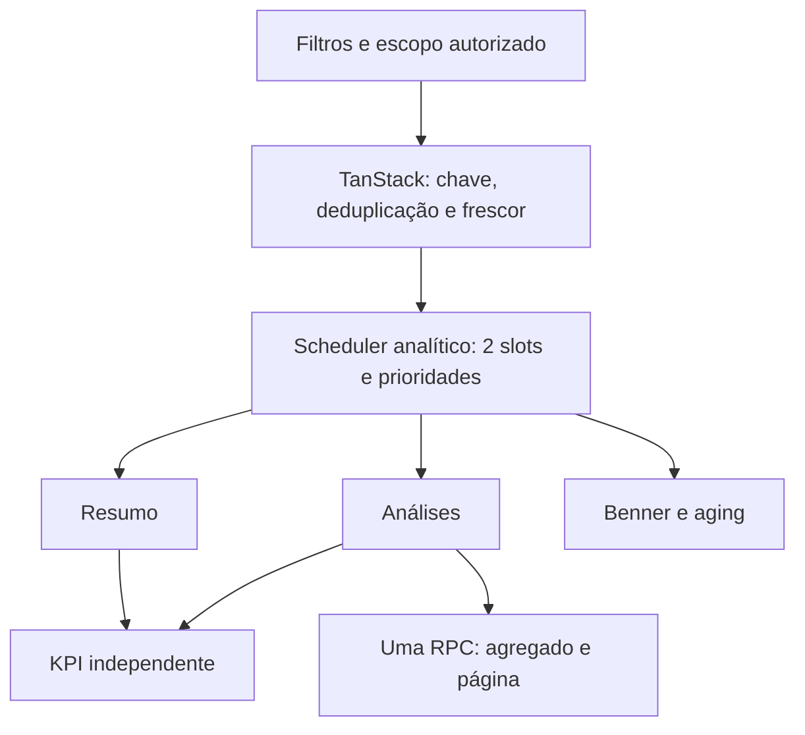

# Arquitetura e decisões

## Antes

Encerramentos iniciava resumo, análises, Benner e aging ao mesmo tempo. TanStack deduplicava por chave, mas retry:false tornava uma recusa de capacidade terminal. As análises eram agregadas no Python após múltiplas páginas/joins remotos; Base Geral reconstruía CTEs globais de fallback.

## Candidata

O scheduler é opt-in, exclusivo de leituras analíticas; autenticação, gravações e filas operacionais não entram nele. Resumo tem prioridade 0, análises 1, Benner/aging 2 e contador secundário 3. Máximo de três tentativas, orçamento total de 20 s incluindo fila e backoff, jitter, Retry-After em segundos/data e cooldown compartilhado em 429. Falhas de identidade, 401/403 e AbortError não repetem. O carregador do resumo mantém seu timeout anterior de 10 s por tentativa dentro desse orçamento.

TanStack mantém retry:false, chaves completas e staleTime existente de 60 s. Não foi criado segundo cache. O cancelamento invalida a lease sincronamente, cancela consultas da chave antiga e descarta respostas de outro filtro/identidade. Os quatro blocos possuem chaves de resultado independentes; falha no resumo não impede análises prontas. Falha de refresh mantém apenas resultado da mesma chave e indica desatualização.

No backend, as tentativas internas de dashboard_fast, etapas e consolidado foram reduzidas a uma. O scheduler é o dono da recuperação dessas leituras. A admissão HTTP por worker e a admissão SQL existente continuam ativas. Abort do cliente não é alegado como cancelamento de SQL.

## Análises SQL

Uma RPC backend-only aplica carteira, período e classificação antes do agregado. Calcula acurácia no coorte após tipo, antes da busca/concordância; a página é ordenada por created_at DESC,id DESC. Não baixa todas as linhas no Python. Perfil/permissão continuam nos decorators; o proxy força carteira do contexto servidor. JSON/API e fuso Campo Grande preservados.

## Base Geral: alternativa escolhida

Não foi criada projeção nem snapshot novo. O diretório canônico existente continua fonte; fallbacks Benner/carteira são lookup LATERAL top-1 por carteira+CNJ normalizado, usando índices funcionais existentes. Predicados dentro do lookup evitam acessos quando dados de maior precedência bastam. Datas, precedência, ordenação, nulls e filtros foram copiados da função efetivamente publicada.

Uma projeção adicional exigiria invalidação/refresh novo, sem necessidade demonstrada no plano. O lookup preserva a mesma visibilidade das fontes em cada statement. A frescura do materialized view processos_directory permanece a já existente, sem ser apresentada como atualização em tempo real.

A primeira alternativa LATERAL com gate no ON não melhorou desempenho: ela ainda executava lookups. O gate passou ao WHERE interno após EXPLAIN ANALYZE. Nenhum índice novo, trigger, write path ou refresh de produção foi alterado.

## Aging e Benner auditados

Benner consolidado já usa uma RPC; não há evidência para recriar sua agregação. Havia até três tentativas no Python, agora uma neste endpoint. O endpoint legado resumo-mes-anterior permanece sem alteração de retry.

Aging faz páginas de validações, páginas de histórico, uma RPC etapas e lotes de 80 pastas no Benner; baseline observou até 12 downstream. Há sobreposição potencial da RPC etapas com o resumo, mas endpoints/coortes e cache de 45 s têm semânticas diferentes. Não foi criada deduplicação entre respostas sem contrato de invalidação comprovado. Mantidos CNJ único, pasta+CNJ, carryover anterior, erro de reconciliação e limite auditável de 10 mil. Essa limitação e a latência remanescente estão abertas; o scheduler reduz a rajada, sem alegar resolver todo custo do aging.

## Segurança

Nenhum token, sessão, documento, grant ou regra de gravação foi alterado. Novas RPCs são SECURITY INVOKER, EXECUTE restrito a service_role. Não há persistência analítica nova. Amostra real contém IDs/CNJs/nomes sintéticos e campos reduzidos; não comprova paridade de texto livre original. Recibos duráveis e atomicidade permanecem fora do patch.
